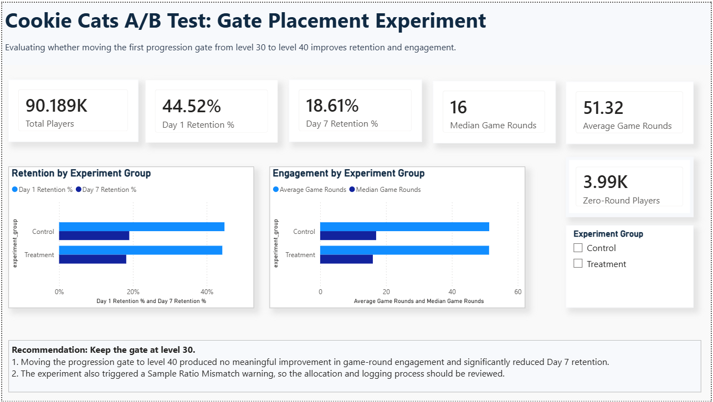
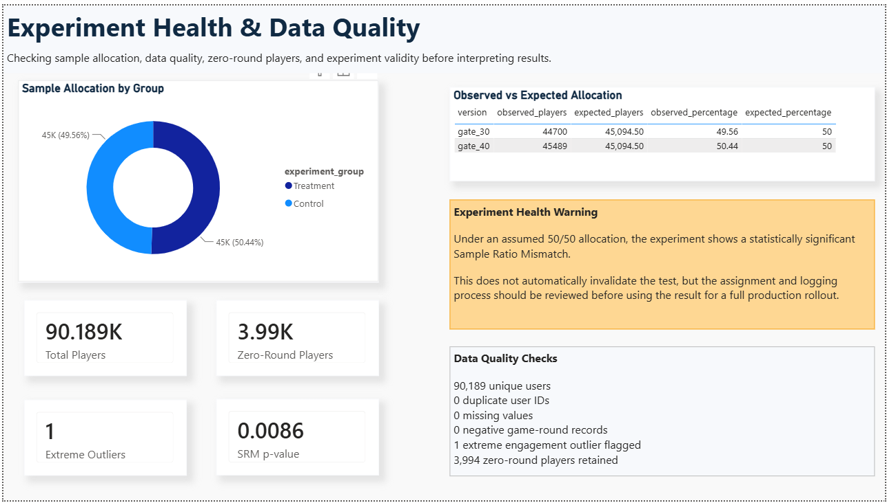
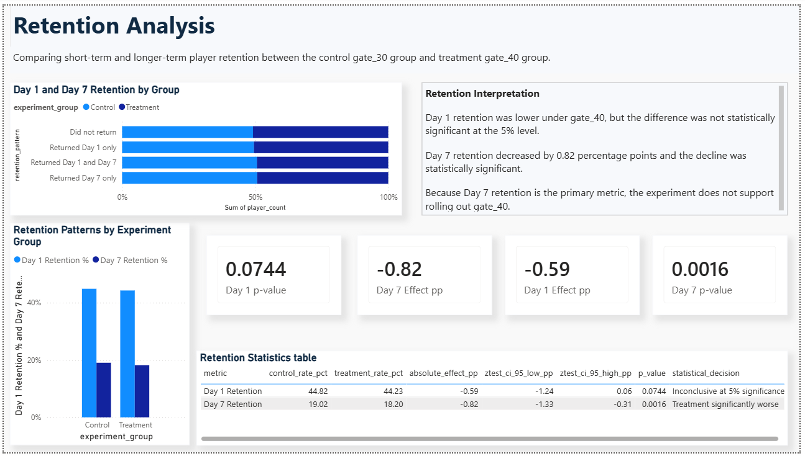
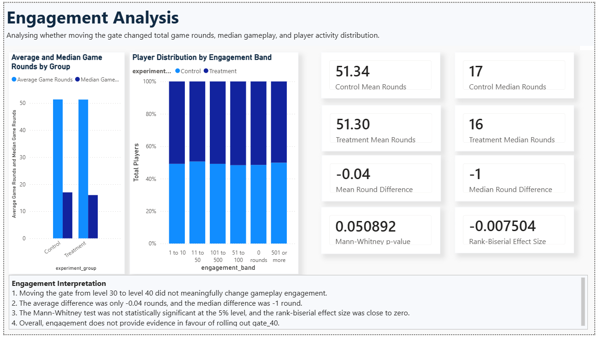
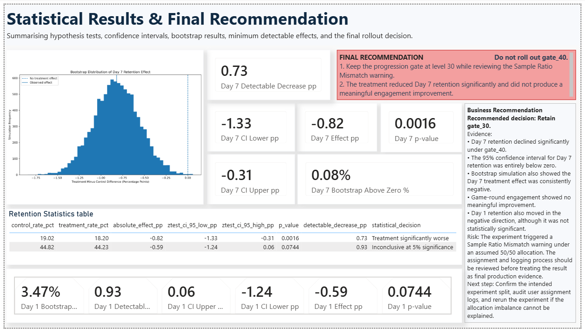

# Cookie Cats A/B Test: Should the First Gate Move from Level 30 to Level 40?

An end-to-end product-analytics case study. It validates experiment data in **PostgreSQL**, tests the effect on retention and engagement in **Python**, quantifies uncertainty with simulation and power analysis, and communicates the decision in a five-page **Power BI** dashboard.

[](https://www.python.org/)
[](https://www.postgresql.org/)
[](https://powerbi.microsoft.com/)
[](https://jupyter.org/)

---

## TL;DR

**Decision: keep the first gate at level 30. Do not roll out level 40 on this evidence.**

- Moving the gate to level 40 **lowered Day 7 retention by 0.82 percentage points** (19.02% to 18.20%, p = 0.0016, 95% CI −1.33 to −0.31 pp).
- Day 1 retention also fell (−0.59 pp), but the test was **inconclusive**: the experiment could only reliably detect drops of about 0.93 pp or more.
- Engagement (game rounds) showed **no meaningful change**, so there is no offsetting benefit.
- The experiment has a **sample ratio mismatch (SRM)** warning (p = 0.0086). The result should be validated against assignment and logging records before it is treated as definitive.

## Key Results

| Metric | Gate at level 30 (control) | Gate at level 40 (treatment) | Difference | Evidence |
|---|---:|---:|---:|---|
| Day 1 retention | 44.82% | 44.23% | −0.59 pp | p = 0.0744, inconclusive |
| **Day 7 retention (primary)** | **19.02%** | **18.20%** | **−0.82 pp** | **p = 0.0016, significant decline** |
| Mean game rounds* | 51.34 | 51.30 | −0.04 | Negligible effect |
| Median game rounds | 17 | 16 | −1 | Negligible effect |

<sub>*Mean rounds exclude one extreme record (49,854 rounds). See [Engagement](#engagement) for a sensitivity check.</sub>

At the observed rates, the Day 7 drop is about **4.3% lower relative to control**, or roughly **8 fewer returning players per 1,000**.

---

## Dashboard Preview



<details>
<summary>More dashboard pages</summary>






</details>

The interactive report is at [`powerbi/Cookie_Cats_AB_Testing_Dashboard.pbix`](powerbi/Cookie_Cats_AB_Testing_Dashboard.pbix). Open it in Power BI Desktop, then point it at your own PostgreSQL instance and refresh.

---

## Business Context

Cookie Cats is a mobile puzzle game. Progression gates pause play until a player waits or makes an in-app purchase. The experiment moved the first gate:

- **Control (`gate_30`):** first gate at level 30
- **Treatment (`gate_40`):** first gate at level 40

**Questions answered**

1. Does the change affect Day 1 or Day 7 retention?
2. Does it change engagement (game rounds played)?
3. Was traffic split as intended, and can the data be trusted?
4. Given the effects and the uncertainty, what should the product team do?

## Dataset

90,189 player-level rows from the Cookie Cats experiment, originally published as a [DataCamp project](https://www.datacamp.com/projects/184) and mirrored on [Kaggle](https://www.kaggle.com/datasets/mursideyarkin/mobile-games-ab-testing-cookie-cats).

| Column | Description |
|---|---|
| `userid` | Unique player identifier |
| `version` | Experiment arm: `gate_30` or `gate_40` |
| `sum_gamerounds` | Game rounds played after install |
| `retention_1` | Player returned on day 1 |
| `retention_7` | Player returned on day 7 |

The raw CSV is not committed. Download it and save it as `data/raw/cookie_cats.csv`.

---

## Approach

| Step | What was done | Tools |
|---|---|---|
| 1. Validate | Row counts, duplicate IDs, nulls, negative values, zero-round players, extreme values | SQL, pandas |
| 2. Model | Analysis view, group KPIs, treatment-effect and Power BI views | PostgreSQL views |
| 3. Check experiment health | Chi-square test for sample ratio mismatch against a 50/50 split | SciPy |
| 4. Test retention | Two-proportion z-tests, absolute effects in percentage points, 95% CIs | statsmodels |
| 5. Quantify uncertainty | Parametric bootstrap, 10,000 simulations, seed 42 | NumPy |
| 6. Check sensitivity | Minimum detectable effect at 80% power and 5% significance | statsmodels |
| 7. Test engagement | Mann-Whitney U, rank-biserial effect size, outlier sensitivity | SciPy |
| 8. Communicate | Charts, summary CSVs, five-page dashboard, written recommendation | Matplotlib, Power BI |

---

## Results in Detail

### Experiment health (SRM)

| Group | Observed players | Expected under 50/50 |
|---|---:|---:|
| `gate_30` | 44,700 | 45,094.5 |
| `gate_40` | 45,489 | 45,094.5 |

χ² = 6.90, **p = 0.0086**. The split differs from 50/50 more than chance alone would usually produce, so allocation or logging should be audited. The test flags a problem but cannot say what caused it.

### Retention

| Metric | Effect | 95% CI (z-test) | 95% CI (bootstrap) | p-value |
|---|---:|---:|---:|---:|
| Day 1 | −0.59 pp | [−1.24, 0.06] | [−1.25, 0.06] | 0.0744 |
| Day 7 | −0.82 pp | [−1.33, −0.31] | [−1.34, −0.31] | 0.0016 |

Day 7 is the primary metric because it reflects sustained return behavior; this choice was made by the analyst, not pre-registered. The bootstrap is parametric (binomial draws from the observed rates), so it closely mirrors the analytic interval and is a consistency check, not independent evidence. Day 7 would also survive a Bonferroni correction across the three tests.

### Statistical power

With these sample sizes, 80% power and a two-sided 5% test, the approximate **minimum detectable decrease** is:

| Metric | Observed decline | Detectable decrease | Reading |
|---|---:|---:|---|
| Day 1 | 0.59 pp | 0.93 pp | Below the threshold, so inconclusive (not "no effect") |
| Day 7 | 0.82 pp | 0.73 pp | Above the threshold, and statistically significant |

### Engagement

The Mann-Whitney U test gave **p = 0.0509** with a rank-biserial effect size of **−0.0075** (negligible). Because one control-group player logged 49,854 rounds, the table below checks whether the mean comparison depends on how that record is handled.

| Outlier handling | `gate_30` mean | `gate_40` mean | Difference |
|---|---:|---:|---:|
| All rows | 52.456 | 51.299 | −1.16 |
| Exclude the single maximum (primary analysis) | 51.342 | 51.299 | −0.04 |
| Winsorize at the 99.9th percentile (1,074 rounds) | 51.031 | 50.935 | −0.10 |

The −1.16 gap with all rows is driven by that single record. Under either reasonable treatment the difference is negligible, and the rank-based test is unaffected by magnitude.

---

## Recommendation

**Keep the gate at level 30 for now.**

1. **Audit the experiment:** randomization, eligibility rules, assignment and event logging.
2. **Explain the SRM** if possible. If it can't be resolved from available records, rerun the experiment with validated allocation and tracking.
3. **Keep Day 7 retention as the primary decision metric**, with Day 1 retention and engagement as supporting metrics.

## Limitations

- **SRM (p = 0.0086).** Some experimentation platforms alert at stricter thresholds (for example p < 0.001), so treat this as a caution flag rather than proof the data is invalid. Either way, it limits how causal the conclusion can be.
- **Intent-to-treat dilution.** Most players never reach level 30 (median rounds are 16 to 17), so the all-player comparison understates the effect on players who actually met the gate.
- **No timestamps or segments.** The dataset has no dates, platform or acquisition fields, so the SRM cannot be investigated within this repository.
- **No revenue data.** Gates drive in-app purchases, so the retention-versus-revenue trade-off is not measured.
- **Retrospective analysis.** The primary metric and outlier rule were chosen after seeing the data.

**Next steps if extended:** analyze players who reached about level 30 (flagged as post-treatment conditioning), add an SRM sensitivity analysis, and incorporate revenue.

---

## Repository Structure

```text
cookie-cats-ab-testing/
├── data/
│   ├── raw/                         # Local dataset (not committed)
│   └── processed/                   # Statistical summary CSVs
├── images/                          # Charts and dashboard previews
├── notebooks/
│   └── 01_ab_testing_analysis.ipynb
├── powerbi/
│   └── Cookie_Cats_AB_Testing_Dashboard.pbix
├── reports/
│   ├── executive_summary.md
│   └── initial_sql_findings.md
├── sql/
│   ├── 01_create_raw_table.sql
│   ├── 02_data_quality_checks.sql
│   ├── 03_create_analysis_view.sql
│   ├── 04_experiment_kpis.sql
│   ├── 05_treatment_effects.sql
│   └── 06_powerbi_views.sql
├── .gitignore
├── README.md
└── requirements.txt
```

---

## Reproduce the Analysis

Developed on Python 3.13.

### Quick start (CSV only, no database)

```bash
git clone https://github.com/RonakGoyal11/cookie-cats-ab-testing.git
cd cookie-cats-ab-testing
python -m venv .venv
source .venv/bin/activate          # Windows: .venv\Scripts\activate
python -m pip install -r requirements.txt
```

Place the dataset at `data/raw/cookie_cats.csv`, run `python -m jupyter notebook`, open `notebooks/01_ab_testing_analysis.ipynb`, and choose **Restart Kernel and Run All Cells**. With no database settings, the notebook falls back to the CSV and regenerates the charts in `images/` and the summaries in `data/processed/`.

### Full pipeline (PostgreSQL and Power BI)

1. **Create the database:** `CREATE DATABASE cookie_cats_ab;`
2. **Create the raw table (once):** connect to `cookie_cats_ab` and run `sql/01_create_raw_table.sql`.
3. **Load the data (once)** from `psql`, in the project root:
   ```sql
   \copy raw.cookie_cats(userid, version, sum_gamerounds, retention_1, retention_7) FROM 'data/raw/cookie_cats.csv' WITH (FORMAT csv, HEADER true);
   ```
   `\copy` is a `psql` command, not plain SQL, and the relative path resolves from where you launched `psql`.
4. **Run the remaining scripts in order:** `02_data_quality_checks.sql` through `06_powerbi_views.sql`.
5. **Configure credentials** in a `.env` file in the project root (never commit it):
   ```dotenv
   DB_USER=your_postgres_username
   DB_PASSWORD=your_postgres_password
   DB_HOST=localhost
   DB_PORT=5432
   DB_NAME=cookie_cats_ab
   ```
6. **Run the notebook.** When the connection succeeds it reads from the `analytics` view; otherwise it uses the CSV.
7. **Open the dashboard** in Power BI Desktop, update the PostgreSQL connection and refresh.

---

## Tech Stack

| Layer | Tools |
|---|---|
| Storage and modeling | PostgreSQL, SQL views |
| Analysis | Python, pandas, NumPy, SciPy, statsmodels |
| Visualization | Matplotlib, Power BI |
| Workflow | Jupyter, Git |

## License

Released under the MIT License. See [`LICENSE`](LICENSE).

## Author

**Ronak Goyal**, B.Tech student focused on business and product analytics.
[GitHub](https://github.com/RonakGoyal11)

## Acknowledgements

Dataset originally from DataCamp's *Mobile Games A/B Testing with Cookie Cats* project (game by Tactile Entertainment).

<sub>This is an analytical case study on a public dataset. Conclusions describe the observed results and their statistical uncertainty; the SRM warning should be investigated before treating them as definitive causal evidence.</sub>